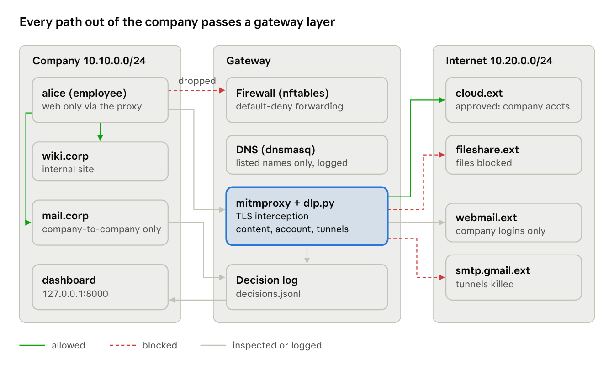

# DLP Gateway Lab — Project Report

## Summary

This project builds a small company network in Docker where a single gateway decides what data may leave. It combines a default-deny firewall, a company DNS server, a TLS-intercepting proxy with a self-written Python DLP engine, and a company-only mail server, and logs every decision to a live dashboard.

In the final system, all 32 functional tests pass and 10 of 11 red-team upload attacks are blocked; the only exception is a 4-byte fragment. Control experiments show that each layer stops leaks no other layer stops: without the firewall, employees bypass the proxy; without DLP enforcement, every content attack succeeds. TLS interception adds about 30 ms per new HTTPS connection.

The main known weakness is slow exfiltration in small pieces: fragments under 1 KB are not judged by the entropy check, so 22 of 23 900-byte pieces of a photo get through.

## Architecture

The gateway is the only container attached to both networks, so every path from the company to the internet crosses it. Direct traffic is dropped by the firewall; web traffic must use the proxy, where the DLP engine decides; mail must use `mail.corp`, which only delivers inside the company.

The proxy shares the gateway's network namespace, so its outbound connections leave through the gateway's own `output` chain while employees' packets are never forwarded.

## Implementation

Every component is a container defined in one `docker-compose.yml`; `docker compose up -d --build` rebuilds the whole lab from source.

| Layer | Technology | What it enforces |
| --- | --- | --- |
| Networks | Docker bridge networks `corp_net` 10.10.0.0/24 and `outside_net` 10.20.0.0/24 | Only the gateway is attached to both |
| Egress firewall | nftables on the gateway | Default-deny: nothing is forwarded from company to outside; employees may reach only the gateway's DNS (53) and proxy (8080) |
| Company DNS | dnsmasq | Answers only for listed `.corp` / `.ext` names; no upstream resolver, every query logged |
| TLS interception | mitmproxy 11 in the gateway's network namespace, company CA trusted by employees | Every HTTPS request is decrypted and inspected |
| DLP engine | Python mitmproxy addon `dlp.py` + `policy.yaml` | Content scanning, approved destinations, company tokens, webmail account check, tunnel restrictions, fail-closed on errors |
| Content scanning | Magic bytes (JPEG, PNG, GIF, PDF, ZIP/Office, GZIP, 7z, RAR), recursive base64 decoding, Shannon entropy > 7.5 bits/byte | Detects files regardless of name, encoding or missing header |
| Identity | HMAC-SHA256 signed tokens (`email:signature`), constant-time comparison | Uploads to approved cloud only for valid `@corp.local` accounts |
| Company mail | Python aiosmtpd server `mail.corp` | Login required, sender must equal login, `From:` header must match, only `@corp.local` recipients |
| Logging | JSON Lines decision log on a shared Docker volume | Every allowed / blocked / monitor decision from proxy and mail server |
| Dashboard | Flask on 127.0.0.1:8000 | Live view of decisions, counts and top block reasons; output escaped against XSS |

The DLP policy lives in `policy.yaml` and reloads while running, separating policy (what is allowed) from mechanism (the code). A monitor mode (`enforce: false`) logs what would be blocked without blocking.

## Test method

All tests run inside the employee container `alice`, using the same tools a real program would (curl, ping), and `run-all.sh` saves each run with a UTC timestamp to `results/`.

| Suite | Checks | What it covers |
| --- | --- | --- |
| `phase1.sh` | 10 | DNS, internal traffic, direct routes out, uploads through the proxy |
| `email.sh` | 12 | Company mail rules, personal mail provider (direct and tunnelled), webmail logins |
| `attacks.sh` | 7 attacks + 2 normal requests | Evasion: renaming, base64 in forms and JSON, prefix bytes, gzip, splitting, HTTP compression |
| `timing.sh` | 4 paths x 20 requests | Average latency with and without proxy and TLS interception |

Every "blocked" test was checked against a control: the destination was shown to be reachable from the gateway, so a block can only come from the lab's rules, not from a server being down.

Three configurations were compared: **A** the full system, **B** with the firewall rules deleted, and **C** with the DLP in monitor mode.

## Results

The full system passes every functional test and blocks every red-team attack except a 4-byte fragment (run of 2026-11-20, `results-A-full.txt`).

### Red-team attacks: before and after the content scanner

"Before" is the engine with magic-byte detection only; "after" adds archive signatures, base64 decoding and the entropy check.

| # | Attack | Before | After | Caught by |
| --- | --- | --- | --- | --- |
| 1 | Photo renamed to `.txt` | Blocked | Blocked | JPEG signature |
| 2 | Base64 in a form field | Leaked | Blocked | Base64 decoding |
| 3 | Base64 inside JSON | Leaked | Blocked | Base64 decoding |
| 4 | 5 bytes prepended | Leaked | Blocked | Entropy 7.99 bits/byte |
| 5 | gzip-compressed file | Leaked | Blocked | GZIP signature |
| 6 | Split into 5,000-byte pieces | 1 of 5 blocked | 4 of 5 blocked | JPEG signature + entropy; 4-byte tail passes |
| 7 | HTTP `Content-Encoding: gzip` | Blocked | Blocked | mitmproxy decodes the body before inspection |
| — | Split into 900-byte pieces | not tested | 1 of 23 blocked | Pieces below the 1 KB entropy minimum pass |
| — | Normal text upload and JSON search | Allowed | Allowed | No false positives |

### Control experiments: is each layer needed?

| Configuration | phase1 | email | Attacks blocked | What failed |
| --- | --- | --- | --- | --- |
| A. Full system | 10/10 | 12/12 | 10 of 11 | Only the 4-byte fragment |
| B. Firewall rules removed | 7/10 | 10/12 | 10 of 11 | Direct HTTP, direct photo upload, direct SMTP (3 tests) |
| C. DLP in monitor mode | 9/10 | 11/12 | 0 of 11 | Photo via proxy, personal webmail login, every attack |

In B the DLP still blocked everything sent through the proxy, but the photo leaked because Alice no longer had to use the proxy. In C the firewall still forced traffic through the proxy, but nothing was blocked there; the mail server's rules held in both, since they are an independent layer.

### Latency

| Request (average of 20) | Time |
| --- | --- |
| wiki.corp, HTTP, no proxy (internal, for scale) | 3.6 ms |
| fileshare.ext, HTTP, via proxy | 10.8 ms |
| fileshare.ext, HTTPS, via proxy with interception | 39.1 ms |
| fileshare.ext, HTTPS, 20 KB photo blocked by DLP | 27.4 ms |

TLS interception adds about 28 ms per new connection: two TLS handshakes instead of one. A blocked request is faster because it is never forwarded or processed by the server, though mitmproxy still opens the upstream connection by default. Measured on a laptop VM with a new connection per request, so these are worst-case, order-of-magnitude figures.

## Findings

The most instructive results were the problems found along the way; each one changed the design.

| Finding | Effect | Fix |
| --- | --- | --- |
| Docker `internal: true` networks drop packets addressed outside their own subnet | Routing through the gateway was silently impossible | Use normal bridge networks and override each container's default route |
| `dig` passed but `ping` failed for company names | Alpine's resolver asks for IPv4 and IPv6 at once and fails if either answer is an error; dnsmasq refused the IPv6 question | `host-record` + `local=` so dnsmasq answers "no IPv6 address" instead of refusing |
| A test for blocked SMTP passed even with the firewall off | Nothing listened on port 25, so the connection was refused anyway | Control runs; an outside mail server so the test can fail |
| An exception in the DLP addon let every request through | mitmproxy forwards the request when an addon crashes: **fail-open** | Wrap inspection in `try/except` and block on any error: **fail-closed** |
| While the addon file had a syntax error, it was not loaded at all | All traffic passed uninspected during edits | Not fixable by code; deploy only tested code, no hot reload in production |
| `host.endswith(domain)` | `evilcloud.ext` would count as `cloud.ext` | Exact match or `"." + domain` suffix |
| mitmproxy's built-in multipart parser drops line-break bytes from binary files | Uploaded files arrive corrupted for inspection | Own byte-exact multipart parser |
| `CONNECT` tunnels to any port | SMTP to a personal provider passed straight through the proxy | Allow `CONNECT` only to port 443 |
| SMTP on port 443 through an allowed tunnel | Non-TLS traffic on 443 passed as raw TCP | Kill any tunnel that carries neither HTTP nor TLS |
| Monitor mode still blocks raw TCP tunnels | `tcp_message` does not use `block()`, so it ignores `enforce: false` | Design decision to document or align |

## Limitations

No network DLP can stop a determined insider; it raises the effort needed and records attempts.

**What network inspection cannot catch**

- Small, slow exfiltration: data split into pieces under 1 KB passes the entropy check. Rate limits per user would be needed.
- Data hidden in normal-looking content: steganography in an allowed image, or text-encoded data under the base64 threshold.
- Anything outside the network: photos of the screen, USB drives, personal phones on mobile data.
- Applications that pin their certificates refuse the company CA and cannot be inspected; they must be blocked or exempted.
- Encrypted data with no recognisable structure on an approved destination is allowed by policy.

**Lab simplifications**

- Mail passwords are stored in plain text in the code and sent without STARTTLS.
- Company tokens are a simplified HMAC format, not full JWT or SSO; the webmail rule checks only the login, not the session cookie afterwards.
- Employees have `NET_ADMIN` in their containers and could change their own routes; real employee devices have no admin rights.
- The decision log is a single JSON Lines file read in full by the dashboard; it would need rotation or a database at scale.
- The proxy, firewall and DNS share one gateway, which is a single point of failure.

## Ethics and legal considerations

TLS interception lets the company read traffic that employees believe is private, so it is only acceptable with clear rules. This lab runs entirely on one laptop with fake services and no real users.
